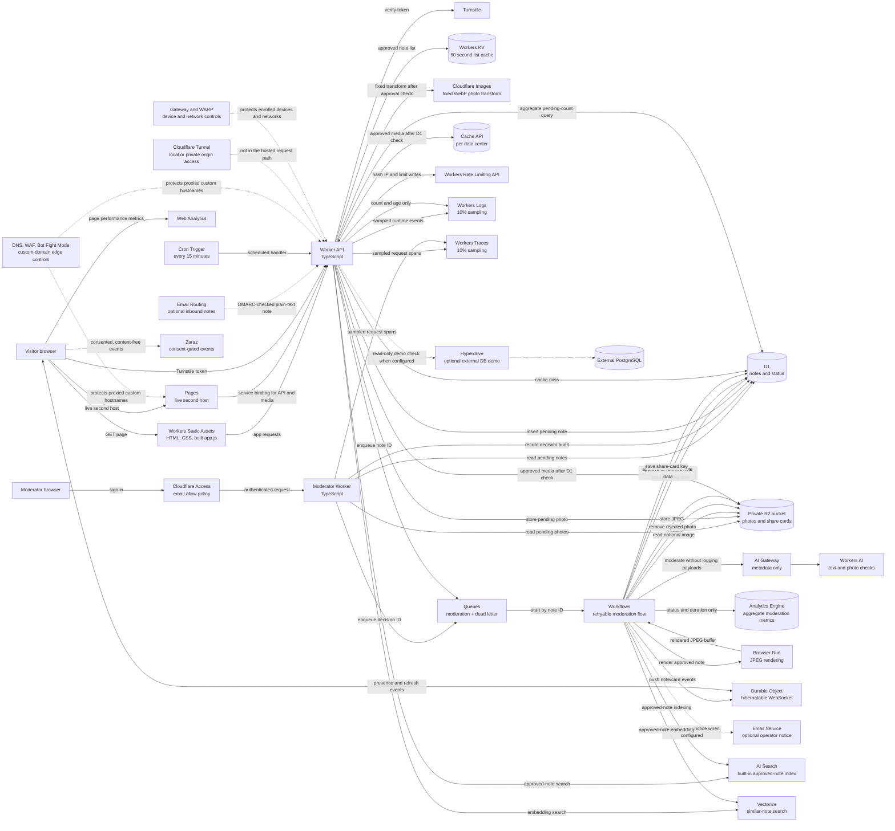

# simple-cf-fullwheel

**Passing Place** is a public guestbook built as a Cloudflare Workers demo. A
visitor can leave a short note, optionally attach a photo, and see approved
notes appear live. Visitors do not need accounts or provide contact fields.
Submissions remain private until automated checks or an authenticated moderator
approves them.

## Contents

- [Quick start](#quick-start)
- [Architecture](#architecture)
- [Cloudflare services used](#cloudflare-services-used)
- [Request and data flow](#request-and-data-flow)
- [Service limits and pricing](#service-limits-and-pricing)
- [Security details](#security-details)
- [Public-repository secret handling](#public-repository-secret-handling)
- [TypeScript structure](#typescript-structure)
- [Deploy](#deploy)
  - [Enable Cloudflare Access for moderation](#enable-cloudflare-access-for-moderation)
  - [Cron health summary](#cron-health-summary)
  - [Live Pages host](#live-pages-host)
  - [Optional Email Service notification](#optional-email-service-notification)
  - [AI Search](#ai-search-enabled)
  - [Vectorize similar-note search](#vectorize-similar-note-search-enabled)
  - [Optional Zaraz events](#optional-zaraz-events)
  - [Optional inbound Email Routing](#optional-inbound-email-routing)
  - [Domain, Tunnel, and device-level services](#domain-tunnel-and-device-level-services)
  - [Worker-to-Worker bindings](#worker-to-worker-bindings)
  - [Workers Traces](#workers-traces)
  - [Optional Hyperdrive demo](#optional-hyperdrive-demo)
- [Port to another Cloudflare account (high-level checklist)](#port-to-another-cloudflare-account-high-level-checklist)
- [Project files](#project-files)
- [Cloudflare service allowances and cost notes](docs/cloudflare-services.md)

## Quick start

Requires Node.js 22.12.0 or newer; `.nvmrc` pins 22.12.0. From the repository root:

```sh
nvm install
nvm use
npm ci
cp -n wrangler.jsonc.example wrangler.jsonc
cp -n wrangler.moderator.jsonc.example wrangler.moderator.jsonc
cp -n .dev.vars.example .dev.vars
npx wrangler types
npm run dev
```

`cp -n` keeps existing local files intact. The Wrangler examples contain sample resource
IDs and a placeholder public Turnstile key; replace these with your account's values
before any remote migration or deployment. The dev command builds the browser TypeScript,
applies migrations to Wrangler's local D1 database, and starts the Worker.
Local D1 rows, KV entries, Queue messages, and R2 photos use Wrangler's local resources.
Workers AI and AI Gateway calls still go to Cloudflare and use the account's AI allowance;
local Analytics Engine writes are discarded. The local Turnstile bypass is accepted
only for loopback hostnames and does not disable Turnstile on a deployed Worker.

To develop the Pages proxy, keep `npm run dev` running and start `npm run pages:dev` in a
second terminal. The Pages dev server connects its `APP` service binding to the local
`passing-place` Worker. See [Deploy](#deploy) to deploy to the account configured in
Wrangler.

## Architecture



Solid arrows show active request or data paths. Dashed arrows show optional integrations or account/device-level services outside the hosted request path.

The public guestbook Worker is the visitor-facing route to D1 and R2. A separate
moderator Worker also has direct D1 and R2 bindings, but Cloudflare Access
protects every request and the application rejects requests without an Access
identity. The R2 bucket has no public bucket URL. Public `/media/:id` and
`/share-cards/:id` routes first check that the matching note is approved, then
fetch the server-generated R2 key. The guestbook browser never receives an R2
object key.

Cloudflare Pages is deployed as a second static host. Its Pages Functions call
the guestbook Worker through the `APP` service binding. That binding is declared
by the caller, `pages/wrangler.jsonc`; it does not appear as an outgoing binding
on the `passing-place` Worker. Moderation stays on the separately protected
Worker and is not proxied through Pages. The moderator Worker uses its own D1,
R2, and Queue bindings; it does not need a service binding to the public Worker.

Workers Traces are enabled on both Workers with 10% head sampling. The query
string is redacted in observability data. The Pages configuration does not
declare a separate observability setting because Wrangler Pages rejects that
configuration; Pages API calls are traced by the bound `passing-place` Worker.

Vectorize and AI Search are provisioned and enabled on the public Worker. They
index approved notes through the Workflow and Cron handlers. AI Search uses a
built-in-storage instance in a dedicated namespace, so it needs no domain or
D1 service API token. Zaraz and inbound Email Routing remain off because they
need a proxied domain. DNS/WAF/Bot Fight Mode, Tunnel, and Gateway/WARP are
account, domain, or device-level features rather than Worker bindings; their
setup boundaries are documented below.

## Cloudflare services used

Status describes this repository's current deployment: **Active** means configured and
deployed, **Off** means the code is present but a prerequisite or feature flag keeps it
disabled, and **Optional** or **Domain-level** means it does not currently serve the
hosted guestbook path.

| Service | Status | Binding or configuration | What it does in this app |
| --- | --- | --- | --- |
| Workers | **Active** | `src/index.ts`, Worker `passing-place`; `src/admin/index.ts`, Worker `passing-place-moderator` | The public Worker runs the API, serves static assets, consumes moderation Queue messages, and handles the scheduled health summary. The second Worker serves a server-rendered moderator interface with D1, R2, and Queue access. |
| Cloudflare Access | **Active** for moderator | Worker-level Access policy on `passing-place-moderator`; `ctx.access` identity check | Restricts the moderator Worker to an explicit email allowlist. The Worker fails closed if Access does not provide an identity. The public guestbook Worker remains public so its WebSocket feature continues to work. |
| Workers Static Assets | **Active** | `ASSETS`, `public/` | Serves the HTML, CSS, icons, and TypeScript app bundle from the same deployment. API and media paths run through the Worker. |
| D1 | **Active** | `DB`, database `passing-place` | Stores notes, moderation status, photo keys, share-card keys, and a metadata-only audit trail for manual moderation actions. Schema changes are in `migrations/`. |
| Turnstile | **Active** | `TURNSTILE_SITE_KEY`, secret `TURNSTILE_SECRET_KEY` | Requires a solved challenge before a note is stored. The server verifies the token, expected hostname, and `guestbook-post` action. It omits the optional visitor-IP field from Siteverify requests. |
| Workers AI | **Active** | `AI` | `@cf/meta/llama-guard-3-8b` reviews names and note text; `@cf/moondream/moondream3.1-9B-A2B` reviews an attached image. Unknown or unsafe moderation results do not publish the note. |
| AI Gateway | **Active** | Gateway `default`, used from `env.AI.run()` | Routes both moderation calls through Cloudflare AI Gateway. It keeps request metadata available while `cf-aig-collect-log-payload: false` prevents prompt and response bodies from being stored in Gateway logs. |
| Queues | **Active** | `MODERATION_QUEUE`, `passing-place-moderation` and `passing-place-moderation-dead` | Separates public submissions and moderator decisions from workflow execution. Messages contain IDs and decision metadata, not note content. Failed automatic delivery retries up to three times before the dead-letter consumer removes private data and marks the note unavailable. |
| Workflows | **Active** | `MODERATION_WORKFLOW`, `passing-place-moderation-workflow` | Gives automatic checks and manual moderator decisions durable, retryable processing. Steps moderate or apply the audited decision, record an aggregate metric, notify connected browsers, index approved notes in AI Search and Vectorize, and render the share card. Search indexing is fail-soft. A failing automatic moderation marks the note unavailable. A content-free operator email is an optional step. |
| Durable Objects | **Active** | `PRESENCE`, class `PresenceHub` | Keeps a single live visitor count and pushes `new-note` and `share-card-ready` events over hibernatable WebSockets. The class uses SQLite-backed Durable Object configuration but stores no application data. The public route requires the same-origin `Origin` header and accepts read-only connections. |
| Browser Run | **Active** | `BROWSER` | Runs Puppeteer in Cloudflare’s headless browser to render an approved note as a 1200×630 JPEG. It uses only a local HTML template; user text is HTML-escaped and page JavaScript is disabled. |
| R2 | **Active** | `PHOTOS`, bucket `passing-place-photos` | Stores optional photos and generated share cards. Objects stay private and are only returned through the approved-note media routes. |
| Cloudflare Images | **Active** | `IMAGES` | Transforms approved uploaded photos to a single 1200×1200 scale-down WebP variant. If transformation fails or the Free allowance is exhausted, the route serves the original approved photo. Share cards are not transformed. |
| Cache API | **Active** | `caches.default` | Caches approved photo and share-card responses per Cloudflare data center. Every request still checks D1 approval first; cache misses fetch the private R2 object and transform photos. Cache entries are best-effort and can be evicted. |
| Workers KV | **Active** | `CACHE` | Caches the approved note list for 60 seconds. The cache is cleared after a note is approved and after its share card is saved. |
| Workers Analytics Engine | **Active** | `MODERATION_METRICS`, dataset `passing_place_moderation` | Writes one aggregate point per completed moderation with status, processing duration, and whether the decision was automatic or manual. It does not receive note text, IDs, IP addresses, or images. The dataset is created on the first remote write. |
| Workers Rate Limiting API | **Active** | `PUBLIC_API_RATE_LIMITER`, namespace `723847291` | Limits guestbook submissions to 5 per minute per hashed client IP, per Cloudflare location. The optional Hyperdrive check has a separate key scope. Cloudflare documents these limits as approximate and eventually consistent. |
| Workers Logs | **Active** | `observability.enabled`, 10% head sampling | Captures sampled invocation, console, and error logs in the dashboard. Application logs avoid note contents, exception messages, and raw IP addresses. |
| Workers Traces | **Active** | `observability.traces`, enabled on the public and moderator Workers at 10% | Captures sampled request paths and platform spans. Query strings are redacted. Persisted traces count toward the shared Observability allowance. |
| Cron Triggers | **Active** | `triggers.crons: ["*/15 * * * *"]` on Worker `passing-place` | Every 15 minutes, queries D1 for the pending-note count and age of the oldest pending note, creates the AI Search instance if needed, and backfills five approved notes into AI Search and Vectorize. It logs aggregates only and does not log visitor content. |
| Cloudflare Web Analytics | **Active** on Worker host | `WEB_ANALYTICS_TOKEN` | Loads Cloudflare’s privacy-focused page performance beacon in the visitor’s browser. The token is public by design. |
| Cloudflare Pages | **Live** | `pages/wrangler.jsonc`, Pages project `passing-place-pages` | Live second host for the same frontend. Pages Functions proxy API, approved media, and WebSocket requests to `passing-place` through the `APP` service binding. Workers Static Assets remains the primary Worker host. |
| Cloudflare Email Service | **Off**; sender domain and verified recipient required | Optional `EMAIL` binding and `EMAIL_*` vars | When configured, sends a short operator notice after approval. It never includes submitted text or photos. The binding should restrict delivery to one verified destination. It stays disabled until sender and recipient setup is complete. |
| Cloudflare Email Routing | **Off**; Cloudflare DNS domain required | `email()` handler; `EMAIL_ROUTING_ENABLED`, `EMAIL_ROUTING_ADDRESS` | When enabled, accepts bounded plain-text emails for one configured address, requires Cloudflare's DMARC-pass result, rate-limits a hash of the authenticated sender, and sends the note through the existing moderation Queue. It rejects attachments and does not store sender addresses. It needs a domain using Cloudflare DNS. |
| Hyperdrive | **Off**; external database required | Optional `HYPERDRIVE` binding | Provides a rate-limited `/api/integrations/hyperdrive` check that runs only fixed `SELECT 1`. It does not replace D1. It needs an external PostgreSQL-compatible database, which has its own provider limits and pricing. |
| AI Search | **Active** | `AI_SEARCH` namespace binding scoped to `passing-place`; `AI_SEARCH_ENABLED=true`; D1 migration `0006_ai_search_index.sql` | Creates the `passing-place-notes` built-in-storage instance on first use, then adds hybrid full-text and semantic search. The Workflow indexes approved notes; Cron backfills older approvals. Search results are reloaded from D1 by their UUID item key before returning, so stale or rejected index entries are not exposed. The index is capped at 6,000 notes and search calls at 900 per month. |
| Vectorize | **Active** | `VECTORIZE` bound to `passing-place-notes`; `VECTORIZE_ENABLED=true`; D1 migration `0005_vector_search.sql` | Adds similar-note search using Workers AI 768-dimensional embeddings. Only approved notes are embedded; a periodic backfill indexes existing approvals. Search results are revalidated against D1 and vectors store IDs only, not visitor text. The index is capped at 6,000 notes to stay below the Free stored-dimension allowance. |
| Zaraz | **Off**; proxied custom domain required | `ZARAZ_ENABLED`, `ZARAZ_CONSENT_PURPOSE_ID`; `window.zaraz.track()` adapter | Emits only note-submitted and search-completed events after the configured Zaraz consent purpose is granted. It sends no names, message text, search text, or IDs. Zaraz script injection and tools are configured in the dashboard and need a proxied custom domain. |
| DNS, WAF, and Bot Fight Mode | **Domain-level**; not configured for app host | Cloudflare zone dashboard | Protect a custom domain at the edge. They do not attach to a `workers.dev` hostname as per-zone settings. Free WAF and Bot Fight Mode setup is documented below; Bot Fight Mode can challenge APIs as well as browser traffic. |
| Cloudflare Tunnel | **Optional**; outside production request path | `cloudflared` tunnel and a route | Publishes a local or private network origin through Cloudflare. It is an operational path for an origin server, not a binding used by this hosted Worker/Pages app; a persistent published hostname requires a domain on Cloudflare. |
| Gateway / WARP | **Optional**; device-level | Cloudflare One Zero Trust organization and device profiles | Filters traffic from enrolled devices and networks. It does not filter anonymous visitor traffic to this public guestbook and has no Worker runtime binding. |

### Request and data flow

1. The browser submits a multipart form. The Worker checks the same-origin
   request and applies the per-location rate limit before parsing the body. It
   then enforces a bounded body size even when `Content-Length` is missing,
   validates field lengths and image signatures, and verifies Turnstile before
   writing data.
2. The Worker inserts the note with `pending` status and stores an optional
   photo in R2. Conditional D1 inserts enforce a lifetime 10,000-note cap and a
   5,000-photo cap even when posts arrive concurrently. The Queue receives
   only the random note ID.
3. The Queue consumer starts one Workflow instance per note ID. The Workflow
   reads the pending note and optional image, then asks Workers AI through AI
   Gateway to moderate them. Gateway retains request metadata but is told not
   to store prompt or response bodies. The Workflow writes only the moderation
   status and duration to Analytics Engine. Rejected content is removed from D1
   and its photo is deleted from R2.
4. An approved note becomes visible in the cached list. A Durable Object pushes
   a refresh event to connected browsers. If Email Service is configured, the
   Workflow also sends a content-free notice to its restricted operator
   recipient. Browser Run makes a share card; the Worker stores the JPEG in R2,
   records its key in D1, clears the cache, and pushes a second refresh event.
5. Reads of photos and cards check the approved status in D1 before consulting
   the per-data-center Cache API. A cache miss fetches the private R2
   object. Cloudflare Images transforms approved photos to WebP; the original
   remains the fallback. Share cards are returned unchanged as downloads.
6. The live Pages host serves the same static frontend and forwards dynamic
   routes to the Worker using a service binding. The optional Hyperdrive check
   runs a fixed `SELECT 1` against a separately configured external database.
7. A moderator signs in through Cloudflare Access and uses the separate
   `passing-place-moderator` Worker to review pending notes. The Worker records
   an action ID, decision, authenticated email, and status in D1, then queues
   only IDs and the decision. Approval publishes the note; rejection clears its
   text and deletes its private photo. Access is applied directly to this
   Worker rather than being relayed through Pages or another service binding.
8. The `*/15 * * * *` Cron Trigger runs the public Worker's scheduled handler.
   It makes one fixed, parameterized D1 aggregate query and logs pending count
   and oldest-pending age for operations.
9. If Email Routing is configured, the Worker's email handler accepts a
   DMARC-authenticated plain-text note for one exact address. It inserts a
   pending note and queues only its generated ID for the same moderation path.
10. An approved note is indexed in AI Search and Vectorize after moderation.
    Cron creates the built-in AI Search instance if needed and backfills five
    older approved notes every 15 minutes. Both search routes reload result IDs
    from D1 and return only notes that remain approved.
11. The browser can search approved notes with either service. Zaraz receives
    only coarse interaction events when the configured consent purpose is
    granted. DNS/WAF, Tunnel, and Gateway/WARP operate at the zone, origin, or
    enrolled-device layer rather than inside the application flow.

### Service limits and pricing

The dated Free-plan allocation table, app-specific behavior, and official pricing
references are in [Cloudflare service allowances and cost notes](docs/cloudflare-services.md).
That snapshot was checked on November 23, 2026; confirm the linked Cloudflare pages
before relying on a limit or enabling usage that could incur charges. The app's own
storage and search caps are separate from Cloudflare's account quotas.

## Security details

- Every D1 query uses fixed SQL text. User-controlled IDs, note text, names,
  media keys, statuses, and limits are passed with D1 `.bind(...)` parameters;
  there is no SQL built by concatenating request values.
- The optional Hyperdrive path uses Postgres.js with one fixed tagged-template
  query (`SELECT 1`); no request values enter SQL. It exposes only a boolean
  connectivity result and stays disabled until explicitly enabled.
- The note/photo-cap insert and share-card-cap update are conditional D1
  statements, so concurrent requests cannot bypass those count limits. User
  uploads are size-bounded before multipart parsing, limited to JPEG/PNG/WebP
  signatures, and stored under server-generated UUID keys.
- The moderator app is a separate Worker protected by a Cloudflare Access
  email allow policy. It independently requires `ctx.access.getIdentity()` for
  every request, checks same-origin form posts, caps and validates form bodies,
  uses prepared D1 statements, and stores the moderator email, decision, and
  action status in its protected audit table. It serves pending photos only
  after checking that the note is still pending; it never creates a public
  pending-photo route.
- Text shown in the browser is assigned through `textContent`. The generated
  share-card template HTML-escapes user text, applies a restrictive CSP, and
  disables JavaScript in the rendering page.
- Rejected or unavailable notes have their text/name cleared and pending photo
  deleted. Media routes only serve notes with `approved` status. R2 is not
  exposed as a public bucket.
- AI Gateway receives moderation requests, but each request disables prompt and
  response payload logging. Analytics Engine stores only status, processing
  duration, decision source, and a fixed dataset index. The rate limiter uses
  a SHA-256 digest of the Cloudflare-provided client address; the raw address
  and caught exception messages are not logged by this code. The digest is
  pseudonymous rather than anonymous and may be guessable; visitors behind the
  same network can also share a rate-limit bucket.
- The optional email notice contains no user content, and its Cloudflare
  binding should restrict delivery to one verified operator address. Email
  addresses and the sender domain are not exposed to the browser.
- Inbound email acceptance requires Cloudflare's trusted DMARC-pass result,
  rejects attachments, and stores neither the sender address nor email headers.
  The rate limiter receives only a SHA-256 digest of the authenticated From
  address. Email body content is treated as a public note and goes through the
  same automated and moderator review path.
- AI Search stores a copy of approved note text in its built-in index, uploaded
  only after moderation. The index is limited to a dedicated Worker namespace;
  result keys are validated and reloaded from D1 with `status = 'approved'`
  before the UI sees them. Vectorize stores generated IDs and embeddings.
- Search POST bodies are size-bounded, same-origin, rate-limited, and limited
  to short queries. The AI Search monthly app budget is persisted in D1 with a
  fixed upsert statement; no query text enters SQL or logs.
- The Worker sends a restrictive Content Security Policy and standard browser
  security headers. The live Pages host has its own `_headers` policy. Both
  allow only the app, Turnstile, Web Analytics, and the page's live connection.
- The local Turnstile bypass is honored only for loopback request hostnames. Setting
  `TURNSTILE_DEV_BYPASS=true` on a deployed Worker does not bypass Turnstile.
- Turnstile is a bot barrier, not user identity or a rate limit. AI moderation
  is probabilistic and can make mistakes; this demo should not be used for
  sensitive or high-risk public submissions.

## Public-repository secret handling

The repository keeps deployment configuration separate from credentials:

- Never commit `.dev.vars`, populated `.env` files, Cloudflare API tokens,
  `TURNSTILE_SECRET_KEY`, email credentials, or database connection strings/passwords.
  Store runtime values in Wrangler secrets or local ignored variable files. In
  particular, a Hyperdrive URL can contain a database password.
- `.gitignore` excludes `.dev.vars*` except `.dev.vars.example`, `.env`/`.env.*` except
  `.env.example`, Wrangler's `.wrangler/` state, `wrangler.jsonc`,
  `wrangler.moderator.jsonc`, and the generated `worker-configuration.d.ts`. The `.example`
  templates are safe to share only while they contain sample values and no credentials.
- `TURNSTILE_SITE_KEY` and `WEB_ANALYTICS_TOKEN` are browser-visible values by design.
  Worker URLs and Cloudflare resource IDs in Wrangler configuration identify resources but
  do not authorize access to them.
- Before publishing, inspect `git status --short` and the staged diff, confirm local files
  are ignored with `git check-ignore -v`, and scan both the working tree and Git history for
  secrets. `.gitignore` does not remove a credential already committed; revoke or rotate
  an exposed credential and remove it from history.

## TypeScript structure

Application logic is authored in TypeScript. `src/client/app.ts` is bundled to
`public/app.js` because browsers execute JavaScript static assets. Wrangler
generates `worker-configuration.d.ts` from the local `wrangler.jsonc`; Git ignores
that generated file. Run `npx wrangler types` after copying or changing the config
templates so Cloudflare bindings and APIs use the installed runtime types.

```text
src/
  index.ts                         Worker routes, asset serving, Queue consumer
  admin/
    index.ts                       Access-authenticated moderation interface
  types.ts                         Cloudflare environment and domain types
  lib/
    http.ts                        JSON responses and security headers
    ids.ts                         Strict UUID validation for route IDs
    logging.ts                     Safe error-type-only operational logs
  routes/
    api.ts                         Form validation and guestbook API
    media.ts                       Approved photo/share-card delivery
  services/
    guestbook.ts                   Prepared D1 queries and KV cache
    moderation.ts                  Workers AI checks and Queue handling
    scheduled-health.ts            Aggregate Cron Trigger health summary
    share-card.ts                  Browser Run rendering and R2 storage
    turnstile.ts                   Server-side Turnstile verification
    analytics.ts                   Aggregate moderation metrics
    email-notification.ts          Optional content-free email notice
    hyperdrive.ts                  Optional fixed PostgreSQL health query
    rate-limit.ts                  Hashed client key for rate limiting
    email-routing.ts               Optional inbound Email Routing integration
    ai-search-index.ts              AI Search instance and approved-note sync
    search.ts                       AI Search and Vectorize query adapters
    search-budget.ts                D1-backed AI Search monthly app cap
    vector-index.ts                 Approval indexing and scheduled backfill
  durable-objects/
    presence-hub.ts                Live count and WebSocket broadcasts
  workflows/
    moderation-workflow.ts         Retryable moderation/card workflow
  client/
    app.ts                         Browser UI, WebSocket, Turnstile, analytics, search
migrations/                        D1 schema migrations
  0001_create_messages.sql         Initial guestbook schema
  0002_moderated_photos.sql        Optional photo metadata
  0003_share_cards.sql             Share-card metadata
  0004_moderation_actions.sql      Manual-decision audit table and indexes
  0005_vector_search.sql           Vector-index marker and bounded search usage
  0006_ai_search_index.sql         AI Search index markers
public/                            Static site and generated app.js
pages/
  functions/                       Pages Functions proxy routes
  wrangler.jsonc                   Live Pages project and service binding
  _headers                         Static response security headers
  _routes.json                     Static asset and Function routing
wrangler.jsonc.example             Public Worker config template
wrangler.moderator.jsonc.example   Moderator Worker config template
worker-configuration.d.ts.example Generation note for ignored Wrangler types
```

The public Worker bindings are generated from `wrangler.jsonc`. After changing
one, regenerate the binding types before checking TypeScript. The moderator
Worker uses the narrow `ModeratorEnvironment` interface in
`src/admin/index.ts`; update it when changing bindings in
`wrangler.moderator.jsonc`.

```sh
nvm use
npx wrangler types
npm run typecheck
npm run build
```

## Deploy

The local `wrangler.jsonc` and `wrangler.moderator.jsonc` files contain account-specific
configuration and are ignored by Git. Their sanitized templates are tracked as
`wrangler.jsonc.example` and `wrangler.moderator.jsonc.example`. A clean checkout must
copy the templates and replace sample resource IDs before running remote commands. The
public Worker for this deployment is
[`passing-place.dragonfrezze.workers.dev`](https://passing-place.dragonfrezze.workers.dev).
The Durable Object, Workflow, and Browser Run bindings are declared in Wrangler
configuration; deploy provisions/updates them with the Worker. Turnstile’s
public site key and Web Analytics token are public vars. Keep
`TURNSTILE_SECRET_KEY` as a Wrangler secret; never put it in `wrangler.jsonc` or
commit it.

```sh
nvm install
nvm use
npm ci
npm run db:remote
npm run deploy
npm run deploy:moderator
```

`npm run db:remote` applies all unapplied D1 migrations in this repository. For an
existing database managed by this repo, this is additive and does not delete note
rows. If a database predates this
migration directory, inspect its schema and migration history before applying
the initial migrations. `npm run deploy` bundles the browser TypeScript,
deploys the public Worker, and configures its Cron Trigger.
`npm run deploy:moderator` deploys the separate moderator Worker. Deploying it
before setting its Access policy is safe: the app returns 403 until Access
provides an authenticated identity.
Wrangler secrets persist across deployments. Analytics Engine creates its
dataset on the first remote write. AI Gateway uses the `default` gateway ID and
creates that gateway on its first authenticated request.

### Enable Cloudflare Access for moderation

After `npm run deploy:moderator`:

1. Open **Cloudflare Dashboard → Workers & Pages → passing-place-moderator →
   Access**.
2. Select **Protect this Worker behind Access**, choose **All traffic**, then
   create or select an **Allow** policy.
3. In the policy, add an **Emails** include rule with the exact email address
   you will use to sign in. Keep the allowlist limited to moderators.
4. Apply the policy and visit the Worker URL Cloudflare shows, expected to be
   `https://passing-place-moderator.dragonfrezze.workers.dev` for this account.

If Cloudflare asks you to enable Zero Trust, complete the free account setup
first. A custom domain is not required. Follow [Cloudflare Access for Workers](https://developers.cloudflare.com/workers/configuration/cloudflare-access/)
for the current dashboard flow. Apply Access only to
`passing-place-moderator`; the public guestbook and its WebSocket endpoint must
remain public. This is a separate Worker because Access identity does not
propagate through the Pages service binding used by the live Pages host.

### Cron health summary

No dashboard resource or secret is required. Deploy the public Worker with
`npm run deploy`; Wrangler reads `*/15 * * * *` from `wrangler.jsonc`. The
schedule is UTC and may take up to 15 minutes to propagate; see the [Cron
Triggers documentation](https://developers.cloudflare.com/workers/configuration/cron-triggers/).
View executions in
**Workers & Pages → passing-place → Settings → Triggers → Cron Triggers** or
check the Worker's sampled logs. The log entry contains only pending count and
the age of the oldest pending note.

### Live Pages host

Pages is already deployed as a second way to serve the same frontend. Its
`APP` service binding points from Pages to the public Worker. To update the
Pages build after changing frontend code, run:

```sh
npm run pages:deploy
```

The project serves at `passing-place-pages.pages.dev`. Its `APP` service binding
forwards `/api/*`, `/media/*`, and `/share-cards/*` to the `passing-place`
Worker, including live-presence requests. It uses the same database and bucket.
Add `passing-place-pages.pages.dev` to the existing Turnstile widget's allowed
hostnames because the Worker checks the exact request hostname. If you want
Web Analytics on Pages, create a Web Analytics site for that hostname and add
its token under the Pages project's **Settings → Variables and Secrets** as a
production variable named `WEB_ANALYTICS_TOKEN`; the Pages proxy uses it for
`/api/config` while the Worker keeps its own site token. If you use a custom
Pages domain, update the WebSocket source in `pages/_headers` and allow that
hostname in Turnstile as well.

### Optional Email Service notification

The integration stays disabled until you configure a sender domain and a
verified recipient in Cloudflare Email Service. On Workers Free, sends to
verified destination addresses are free; arbitrary recipients require Workers
Paid. Onboard the sender domain, verify the recipient, then add this binding to
`wrangler.jsonc` using your verified address:

```jsonc
"send_email": [
  {
    "name": "EMAIL",
    "destination_address": "verified-recipient@example.com"
  }
]
```

Set `EMAIL_NOTIFICATIONS_ENABLED` to `"true"` in `wrangler.jsonc`. Store the
sender and recipient as Worker secrets so addresses do not need to be committed
to the repository:

```sh
npx wrangler secret put EMAIL_FROM
npx wrangler secret put EMAIL_TO
```

Use an address on the onboarded domain for `EMAIL_FROM` and the same verified
recipient as the binding for `EMAIL_TO`. Regenerate types, then deploy. The
binding restriction prevents this Worker from sending to other recipients.
Email failures do not delay or undo publication.

### AI Search (enabled)

AI Search is configured as a built-in-storage instance in the dedicated
`passing-place` namespace. The Worker creates `passing-place-notes` on first
search or the next Cron run, so it needs no D1 service API token, external
resource, or custom domain. The namespace binding is declared in
`wrangler.jsonc` and scoped to this app.

The moderation Workflow uploads a Markdown item only after approval. Cron
backfills five older approved notes every 15 minutes. Each item key is the
guestbook UUID plus `.md`; D1 remains the source of truth, and every search
result is looked up again by UUID and filtered for current approval before the
browser receives it. A D1 migration tracks index status. Indexing stops at
6,000 notes, and the app caps searches at 900 calls per UTC month to leave
headroom below the included 1,000 semantic and 1,000 full-text queries. The
monthly query cap does not include usage from other AI Search instances.

AI Search billing starts Dec 1, 2026, and use above included monthly amounts is
billable. For another Cloudflare account, keep the namespace binding and feature
flag enabled, apply the D1 migrations, regenerate types, then deploy. A built-in
instance is created automatically. Cloudflare's [Worker binding
guide](https://developers.cloudflare.com/ai-search/api/instances/workers-binding/)
covers instance management; its [item binding
guide](https://developers.cloudflare.com/ai-search/api/items/workers-binding/)
covers uploading and maintaining indexed content.

### Vectorize similar-note search (enabled)

Vectorize uses Cloudflare's [`@cf/baai/bge-base-en-v1.5` embedding
model](https://developers.cloudflare.com/workers-ai/models/bge-base-en-v1.5/),
which returns 768 dimensions. The `passing-place-notes` cosine index is created,
bound as `VECTORIZE`, and enabled on the public Worker. Migration
`0005_vector_search.sql` is applied to the remote D1 database.

For another Cloudflare account, create an index with:

```sh
npx wrangler vectorize create passing-place-notes --dimensions=768 --metric=cosine
```

Then add the binding to `wrangler.jsonc` and set `VECTORIZE_ENABLED` to
`"true"`:

```jsonc
"vectorize": [
  { "binding": "VECTORIZE", "index_name": "passing-place-notes" }
]
```

Run `npx wrangler types` and deploy. New approved notes are embedded by the
durable moderation workflow. The Cron
Trigger backfills five older notes every 15 minutes. Indexing stops at 6,000
notes (4.608 million stored dimensions) to leave headroom below the 5 million
dimension Free allocation. It stores only note IDs in Vectorize; D1 remains the
source for the text and approved status. The search endpoint rechecks that
status before returning a match. Vectorize query-dimension usage and Workers AI
embedding usage have separate account allowances.

### Optional Zaraz events

Zaraz needs a custom domain on Cloudflare DNS, proxied through Cloudflare; the
`workers.dev` and `pages.dev` hostnames are not enough. For Pages, attach a
custom domain to the live Pages project. In the dashboard, configure Zaraz on
that zone, enable Auto Injection, add the tools you want, and configure the
Consent Manager with a purpose for analytics events. See Cloudflare's [Pages
setup guide](https://developers.cloudflare.com/pages/how-to/enable-zaraz/) and
[consent API](https://developers.cloudflare.com/zaraz/consent-management/api/).

Set `ZARAZ_ENABLED` to `"true"` and `ZARAZ_CONSENT_PURPOSE_ID` to that consent
purpose's ID in the public Worker's variables, then deploy. The client calls
`zaraz.track()` only after the Consent API reports that purpose as granted. It
sends only `guestbook_note_submitted` and `guestbook_search_completed` with a
channel/provider and result count; it never sends text, names, search queries,
or note IDs. Without the proxied custom domain, the adapter safely does nothing.
Zaraz includes one million events per account each month; overage is billed
only if Zaraz Paid is enabled, otherwise event processing stops for that cycle.

### Optional inbound Email Routing

Email Routing needs a domain onboarded to Cloudflare DNS. Follow Cloudflare's
[routing setup guide](https://developers.cloudflare.com/email-service/get-started/route-emails/),
create one exact address such as `notes@example.com`, then add a routing rule
whose destination is the `passing-place` Worker. Set `EMAIL_ROUTING_ENABLED` to
`"true"` and `EMAIL_ROUTING_ADDRESS` to that exact address in `wrangler.jsonc`,
then deploy.

The handler accepts a 3–240 character plain-text body with no attachments, up
to 64 KB total email size. It requires Cloudflare's trusted DMARC result to
pass, rate-limits a hash of the authenticated RFC From address, stores the
public author as `Email visitor`, and sends the note through the same pending
moderation Queue. It never stores or logs the sender address. The email sender
does not receive an automatic reply. Inbound routing is free, while each
invocation still uses the Worker request allocation. This is separate from the
outbound operator-notification binding described above.

### Domain, Tunnel, and device-level services

These services do not need source-code bindings:

- **DNS, WAF, and Bot Fight Mode:** add a domain to Cloudflare, update its
  registrar nameservers, attach it to Pages or the Worker, and proxy the web
  hostname. Verify the Free Managed Ruleset is enabled, then enable Bot Fight
  Mode under **Security → Settings → Bot traffic** if you want it. It applies
  across the zone and may challenge legitimate API or mobile traffic; review
  Security Events after enabling it. Zone rules cannot be applied to the shared
  `workers.dev` or `pages.dev` hostnames.
- **Cloudflare Tunnel:** use it to publish a local/private server behind
  `cloudflared`. This guestbook already runs on Workers and Pages, so a Tunnel
  does not sit in its production request path. A persistent published hostname
  requires a domain on Cloudflare and a machine or VM running `cloudflared`.
- **Gateway / WARP:** create a Zero Trust organization, enroll chosen devices
  with Cloudflare One Client, and add Gateway DNS/HTTP policies if you want
  filtering for those devices. This controls your own device/network traffic;
  it does not filter public visitors to the guestbook.

### Worker-to-Worker bindings

The live service binding is `passing-place-pages` → `passing-place`, exposed as
`APP` in `pages/wrangler.jsonc`. Cloudflare configures this on the caller, which
is why it does not show as an outgoing binding on the public Worker. The
moderator Worker intentionally has no service binding to the public Worker: it
uses its own D1, R2, and Queue bindings behind Access, and Cloudflare Access
identity does not propagate across service bindings. Adding a public-to-admin
binding would create a privileged call path without a feature that needs it.

### Workers Traces

Workers Traces are enabled in both `wrangler.jsonc` and
`wrangler.moderator.jsonc` at 10% sampling. Query strings are redacted. Both
Workers have been deployed with this setting; traces should appear as requests
arrive. No dashboard resource or secret is required. Free ingestion stops for the day
when the account allowance is reached. From Dec 1, 2026, persisted traces share
the Observability Free allowance of 0.5 GB/day ingestion and seven-day
retention with supported log datasets. See Cloudflare's [traces configuration
guide](https://developers.cloudflare.com/observability/traces/configuration/).
The Pages proxy itself does not declare this setting because Pages Wrangler
rejects `observability`; requests it sends to `passing-place` appear in that
Worker's traces.

### Optional Hyperdrive demo

Hyperdrive pools connections to an external PostgreSQL-compatible database; it
does not provide a database. The provider has its own plan and billing. Keep its
connection string private; do not send it in chat or commit it. Create the
Hyperdrive configuration in the Cloudflare dashboard or with Wrangler, then add
the returned ID to `wrangler.jsonc`. The dashboard avoids placing the connection
string in a local process argument. If you use the CLI below, hidden input keeps
it out of shell history, but Wrangler still receives it as an argument while it
runs; use a trusted machine and never put the value directly in the command.

```sh
printf "Paste database URL (input hidden): "
read -s HYPERDRIVE_CONNECTION_STRING
printf "\n"
npx wrangler hyperdrive create passing-place-demo --connection-string="$HYPERDRIVE_CONNECTION_STRING"
unset HYPERDRIVE_CONNECTION_STRING
```

```jsonc
"hyperdrive": [
  {
    "binding": "HYPERDRIVE",
    "id": "<hyperdrive-id>"
  }
]
```

Set `HYPERDRIVE_DEMO_ENABLED` to `"true"`, regenerate types, and deploy. The
read-only `GET /api/integrations/hyperdrive` route runs fixed `SELECT 1`, is
rate-limited, and returns no database metadata. The guestbook continues to use
D1.

## Port to another Cloudflare account (high-level checklist)

This is a resource checklist, not an automated or fully self-contained provisioning
guide. Create resources in the new account, update account-specific IDs and names in
both Worker configurations, and follow the feature-specific setup sections above.
Start with the `wrangler.jsonc.example` and `wrangler.moderator.jsonc.example` templates
from [Quick start](#quick-start). Replace their sample IDs before using remote Wrangler
commands; `npx wrangler types` generates the ignored local type file.

Sign in with `npx wrangler login`, then create a D1 database, KV namespace, R2
bucket, and the moderation and dead-letter Queues. Replace the D1 database ID
and KV namespace ID in `wrangler.jsonc`; keep resource names aligned with the
created R2 bucket and Queues. Set up a Turnstile widget for the deployed
hostname, add its secret with `npx wrangler secret put TURNSTILE_SECRET_KEY`,
and apply migrations. Cloudflare Web Analytics needs its hostname/site token;
set the public token in `wrangler.jsonc`. Wrangler also declares Images,
Analytics Engine, the Rate Limiting API, Workers Logs, and Workers Traces. Set
up a Pages project and service binding for the second static host. The current
configuration enables AI Search and Vectorize: create the Vectorize index and
apply both search migrations for the new account before deploying. AI Search
creates its built-in instance from the dedicated namespace binding. Zaraz and
inbound Email Routing still need the domain setup described above.
Zone security, Tunnel, and Gateway/WARP require the account/domain/device setup
described above. Email Service outbound notices need a sender domain and verified
recipient; Hyperdrive needs an external database.

## Project files

- `wrangler.jsonc` declares the public Worker, Static Assets, service bindings,
  Queues, Durable Object, Workflow, Browser Run, Images, Analytics Engine, rate
  limiter, Cron Trigger, and observability configuration. Its safe template is
  `wrangler.jsonc.example`.
- `wrangler.moderator.jsonc` declares the separate moderator Worker and its
  D1/R2/Queue bindings, plus a local-only mock Access identity for development.
  Its safe template is `wrangler.moderator.jsonc.example`.
- `pages/wrangler.jsonc`, `pages/functions/`, and `pages/` define the live Pages
  host and its service-binding proxy.
- `worker-configuration.d.ts` is generated locally from that configuration and ignored;
  `worker-configuration.d.ts.example` documents how to regenerate it.
- `src/` contains the TypeScript Worker, routes, services, Workflow, Durable
  Object, and browser app.
- `public/` contains static assets and the generated browser bundle.
- `migrations/` contains versioned D1 schema changes.
- `docs/cloudflare-services.md` records the dated Cloudflare quota and pricing
  reference.
